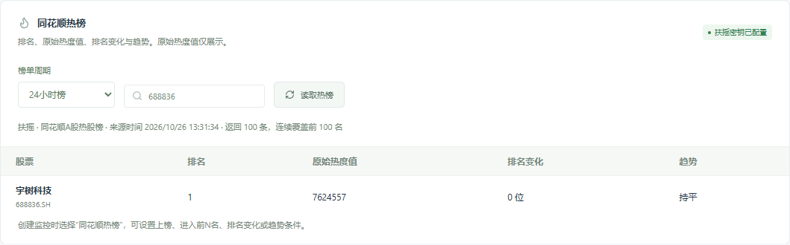
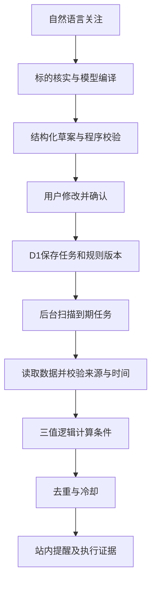

# 风险雷达 · Risk Radar Agent

把自然语言投资关注转换成可检查、可修改的监控规则，经用户确认后在后台执行，并解释为什么触发、没有触发，或因数据不足无法判断。

| 交付入口 | 地址 |
| --- | --- |
| Web 产品 | https://risk-radar-agent-xjc.pinkstoat514.chatgpt.site |
| GitHub 仓库 | https://github.com/dungeonmasterrrr/risk-radar-agent |
| 使用说明 | 本 README |
| 架构与实现 | [ARCHITECTURE.md](docs/ARCHITECTURE.md) |
| 测试说明 | [TESTING.md](docs/TESTING.md) |

**访问说明：当前线上站点为所有者私有访问，仓库也按私有方式交付。评审或协作者需要分别获得站点和仓库权限；知道 URL 不代表已经获得访问权限。**

## 目标用户与使用场景

面向有明确股票标的、触发条件和检查频率的个人投资者及投研人员，帮助他们持续跟踪价格、公告、指定时间和市场关注变化。

例如：

- “茅台价格低于1400元时提醒我，每5分钟检查，使用扶摇。”
- “招商银行进入同花顺热榜前50名时提醒我，使用扶摇。”
- “宁德时代出现回购公告，且进入热榜前50名时提醒我，使用iFinD。”
- 指定一个包含日期、时刻和时区的日历提醒。

产品负责监控、解释和站内提醒，不执行买卖，也不提供收益承诺。

## 已实现功能

| 模块 | 当前能力 |
| --- | --- |
| 自然语言创建 | 模型生成结构化草案；检查标的、参数和数据能力；歧义时请求补充；可修改后确认启用 |
| 标的选择 | 按名称或代码搜索，真实任务保存前核实代码与市场；原有五个标的仅作快捷示例 |
| 价格 | 扶摇及iFinD价格接入；保留来源时间，缺失或过期时不以其他价格替代 |
| 公告事件 | iFinD公告标题与片段关键词检索，校验标的、日期和回看窗口，生成稳定的本地去重标识 |
| 日历 | 用户指定的绝对时间提醒；交易时段任务使用对应来源的交易日历 |
| 热榜 | 同花顺24小时榜／小时榜；展示排名、原始热度值、排名变化、趋势；支持上榜、前N名、排名变化与趋势条件 |
| 组合规则 | 最多8个条件，支持单层“全部满足 AND”或“任一满足 OR” |
| 任务运行 | 暂停／恢复、到期调度、失败退避、租约与并发保护、规则版本、执行记录和操作日志 |
| 提醒与解释 | 命中周期去重、公告去重、通知冷却；记录触发理由、数据来源、来源时间和原始证据 |
| 数据查询 | 在“运行与数据”手动查询iFinD公告、新闻、热门资讯及扶摇热榜 |
| 演示与异常 | 可复现的命中、恢复、过期、冲突、超时和字段缺失场景，始终标记为模拟数据 |



截图是接口验收时的页面记录，展示值不代表当前行情。

## 核心设计

### 1. 规则先确认，再执行

统一任务模型包含：标的、数据来源、条件数组、AND／OR逻辑、检查间隔、检查时段、通知冷却和数据有效期。自然语言生成的是草案，只有用户核对并确认后，后台才会创建任务。



### 2. 区分“不满足”和“无法判断”

条件结果为 `true / false / unknown`。数据过期、来源缺失、字段冲突、接口失败或覆盖不足时返回 `unknown`，不伪装成正常的“未满足”。组合条件使用三值逻辑，保留每一项的理由和证据。

### 3. 后台执行与网页分离

任务、版本、执行状态和下次检查时间持久化在D1中。执行使用租约、revision并发检查、执行请求幂等键及通知唯一键，防止重复执行或过期执行者覆盖新结果。

暂停后恢复保留去重与冷却状态；用户确认新版本后重置相关运行状态，历史执行仍关联旧版本。

**当前频率必须区分：**

- 本地 `dev:all` 启动独立调度进程，每15秒扫描到期任务。
- 当前线上Sites部署由关联后台任务每小时扫描一次。
- 规则中的“每5分钟”是目标间隔，不代表当前线上已具备每5分钟执行能力。分钟级云端监控需要常驻调度器或确认可用的分钟级定时平台。

### 4. 热度采用可追溯的热榜口径

热榜来自扶摇同花顺A股热股榜，每次按周期请求前100名：

- 排名、原始热度字符串、排名变化和趋势分别展示。
- **原始热度值只展示，不生成0–100评分，也不参与数值阈值触发。**
- 排名变化和趋势沿用上游字段，不擅自解释为相对本系统上次检查的变化。
- 榜单覆盖不足、时间过期或关键字段缺失时不能直接判断未上榜。
- 旧数值热度规则保留历史并提示更新，编辑确认后才使用新规则。

详见 [HEAT_SETUP.md](docs/HEAT_SETUP.md)。

## AI 角色

### 产品运行中的AI

Gemini负责把自然语言转换为结构化规则草案。程序负责核实标的、检查参数、验证数据能力，并对明确的热榜参数作二次核对。输出未通过校验、模型限流或不可用时，明确显示降级原因，使用受限本地解析器或请求用户补充信息。

周期检查、条件计算、去重、冷却和通知由确定性代码执行；模型不直接启用任务、不决定买卖，也不在每次轮询中自由推断事件是否成立。

当前主要使用Gemini结构化输出，保留OpenAI Responses适配。不会在模型失败时自动切换付费提供方。

### 开发过程中的AI

开发过程中使用Codex辅助需求拆解、代码实现、调试、测试与文档整理。验收依据是程序测试、真实接口调用、浏览器操作和部署结果；未做大规模模型效果评估，不把模型生成的内容当作已验证事实。记录见 [AI_USAGE.md](docs/AI_USAGE.md)。

## 数据使用

| 来源 | 用途 | 重要边界 |
| --- | --- | --- |
| 扶摇REST API | A股／指数价格、交易日历、同花顺热股榜 | 需账号权限；保留上游时间；热榜仅覆盖指定返回范围 |
| iFinD MCP | 股票／指数价格、公告关键词监控、手动新闻与热门资讯查询 | 语义检索返回相关片段，不保证完整覆盖；权限和额度取决于账号 |
| 内置演示 | 验证主链路、组合条件、通知与异常处理 | 明确标记`simulated`，不代表真实市场 |
| 腾讯／Yahoo | 保留的实验行情适配 | 无SLA，可能延迟、限流或不可用；当前主线验收聚焦A股扶摇与iFinD |

公告仅带日期时，不能编造分钟级发布时间；检索为空也不能断言不存在公告。iFinD热门资讯查询与同花顺热股榜是两种数据能力，不能混作同一个热度指标。

真实数据和模型密钥只放在服务端。本仓库不包含实际API密钥、本地数据库、用户任务数据或部署访问令牌。外部接口调用会使用配置账号的额度。

接入细节：[数据契约](docs/DATA_CONTRACT.md) · [扶摇](docs/FUYAO_SETUP.md) · [iFinD MCP](docs/IFIND_SETUP.md) · [Gemini](docs/GEMINI_SETUP.md)。

## 技术栈与目录

React 19、TypeScript、Vinext／Vite、Cloudflare Workers、D1／SQLite、Drizzle，以及服务端REST／MCP数据适配。

```text
app/                 工作台页面与API路由
components/          规则编辑器、试算、数据连接与热榜组件
core/                模型编译、规则校验、数据适配、存储和执行引擎
db/ + drizzle/       数据库定义和迁移
worker/              Worker fetch与scheduled入口
scripts/             本地启动、独立调度器和验证工具
tests/               自动化测试
docs/                设计、数据契约、AI记录和验证说明
```

项目基于Sites／Vinext starter构建；第三方代码及许可证保留在对应文件与`vendor/`目录中。

## 本地启动

需要Node.js 24和npm。

```sh
git clone https://github.com/dungeonmasterrrr/risk-radar-agent.git
cd risk-radar-agent
npm ci
npm run dev:all
```

打开终端输出的 `http://127.0.0.1:5173`。首次启动会应用本地数据库迁移，生成被Git忽略的`.dev.vars`和调度密钥，启动网页及独立调度进程。`Ctrl+C`停止服务。

没有外部密钥也可载入演示任务、使用本地解析器和结构化编辑器。只运行`npm run dev`不会同时启动独立调度器。

需要真实能力时，在`.dev.vars`按[.env.example](.env.example)填写：

| 配置项 | 用途 |
| --- | --- |
| `MODEL_PROVIDER=gemini` | 选择Gemini模型适配 |
| `GEMINI_API_KEY` | 自己的Gemini API密钥 |
| `GEMINI_MODEL` | 模型名称；当前项目使用`gemini-3.1-flash-lite` |
| `FUYAO_API_KEY` | 扶摇价格、日历和热榜权限 |
| `IFIND_MCP_API_KEY` | iFinD MCP价格、公告和资讯权限 |
| `SCHEDULER_SECRET` | 调度接口鉴权；本地一键启动可自动生成 |

修改配置后重启服务。不要把真实值写入README、前端或Git提交。

## 手动验收

1. 载入演示任务，查看明确的模拟标记。
2. 创建监控，输入关注点，核对草案、数据来源、检查间隔和冷却后确认。
3. 点击“试算草案”或保存后的“立即检查”，查看每项条件与来源时间。
4. 在演示任务切换“模拟命中／条件恢复／数据过期／接口超时”等场景，验证提醒、去重、冷却和降级。
5. 编辑任务并确认新版本，查看旧版本和执行证据；暂停／恢复时观察状态。
6. 在“运行与数据”测试真实iFinD查询和同花顺热榜。真实行情不一定满足触发条件。

## 测试与构建

最近完整验收：**157项自动测试通过**，另有TypeScript检查、生产构建、真实接口与桌面／手机浏览器验证。

```sh
npm test
npm run typecheck
npm run build
```

覆盖规则边界、模型降级、HTTP／业务错误、来源与新鲜度、部分榜单、公告时间精度、组合逻辑、通知去重、冷却、版本和并发租约。测试默认使用本地数据库和模拟接口，不需要真实数据密钥。

验证材料：[测试说明](docs/TESTING.md) · [本次单元测试报告](docs/validation/release-unit-results.xml) · [热榜浏览器记录](docs/validation/heat-browser-results.json)。

## 部署说明

当前站点使用Sites托管，Worker连接D1的`DB`绑定。`.openai/hosting.json`保留当前站点身份，`drizzle/`保存数据库迁移。克隆代码不会自动获得现有站点、数据库或生产密钥的访问权限；新部署需要配置自己的站点、数据库绑定及服务端secrets。

项目提供Worker `scheduled`入口和密钥保护的`POST /api/radar/tick`。源码包含cron声明，但只有实际观察到心跳与执行记录，才能确认目标平台的定时任务已经生效。当前Sites每小时调度的说明见 [CLOUD_UPDATES.md](docs/CLOUD_UPDATES.md)。

独立调度器通过`RADAR_ORIGIN`连接应用，并与应用使用相同的`SCHEDULER_SECRET`；生产运行需要进程管理器或系统服务保持进程常驻。详见 [DEPLOYMENT.md](docs/DEPLOYMENT.md)。

## 已知边界与未做事项

- 当前站点和仓库为私有访问；尚未完成面向外部评审的访问授权。
- 当前云端每小时扫描任务，尚未实现稳定的分钟级云端监控；任务多时可能排队延迟。
- 每空间最多50个任务、每条最多8个条件；不支持嵌套逻辑、同任务多标的和任意指标表达式。
- 热榜仅支持A股股票，排名条件最多前100名；原始热度值不参与数值阈值判断。
- 公告检索不是全量公告订阅；日期精度、检索遗漏和数据入库延迟会影响判断。自动发现未来财报／分红日历尚未实现。
- 仅有站内提醒，没有短信、邮件或其他外部通知，也没有自动交易。
- 本地cookie空间隔离不等同完整账号系统；面向多用户公开部署前仍需完善身份、权限与调度入口鉴权。
- 已做代表性真实接口联调，但未验证全部标的及账号权益；没有高可用、压力测试或外部数据SLA保证。
- 未做系统性的模型准确率评估；模型失败仍可能需要用户澄清或手动编辑规则。
- 60–180秒演示视频及正式对外提交材料尚未完成。

需求映射见 [REQUIREMENTS.md](docs/REQUIREMENTS.md)。
