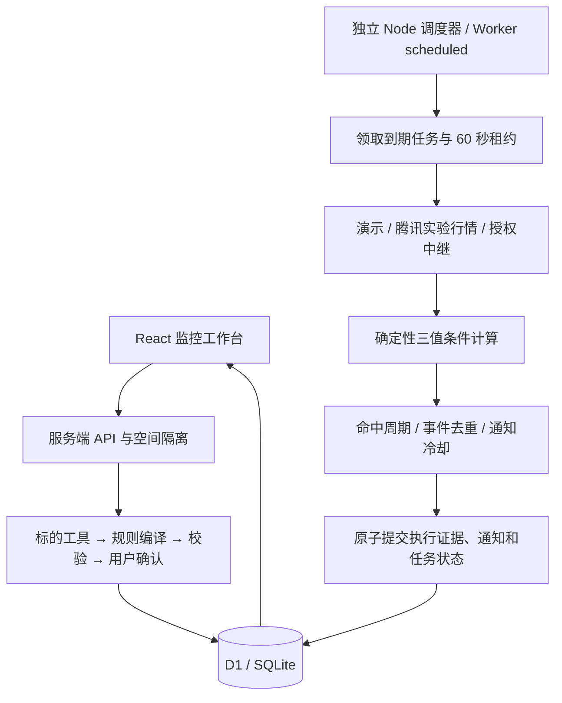

# 架构与运行语义

前端 React，Vinext 提供服务端 API 与 Cloudflare Workers 运行入口，D1 持久化结构化记录。核心规则、Agent、调度和通知策略以独立 JavaScript 模块实现；测试使用 Node 24 内置 SQLite 执行相同 SQL 与事务。

## Agent 的权限与模型降级

Agent 是受约束的规则编译流程：核对唯一标的、请求结构化草案、服务端校验、澄清或展示草案。只有用户明确确认才能启用。没有自由执行代码、交易或任意联网权限。模型不参与周期性阈值计算，不负责凭空生成行情与结论。

模型未配置或失败时使用受限本地解析器，界面与 trace 如实披露；该解析器不是大模型。当前支持少量明确中文模式，不能保证理解任意自然语言。超出支持范围的指标和模糊表达要求澄清。

## 三类状态

- 生命周期：active／paused。
- 执行健康度：pending／healthy／degraded。
- 条件结果：matched／not_met／unknown／skipped。

unknown 不覆盖上次确定的命中状态，防止数据故障恢复后重复提醒。组合条件采用三值逻辑：false AND unknown 为 false；true OR unknown 为 true；只要存在未知子条件，整体健康度仍降级。

## 通知语义

- 价格／热度：整体条件从不满足变为满足时形成新命中周期，同周期只通知一次。
- 事件／日历：按稳定身份去重。旧公告消失后再次出现，仍不重复通知。
- 冷却：从最近一次实际通知开始计时；冷却内只记录，不消耗未通知身份或周期；冷却结束时仍满足可通知。
- 暂停恢复：保留条件周期、已通知事件与冷却。
- 新版本：明确重置周期、去重与冷却，可能对仍满足的条件产生一次新通知；历史仍关联旧版本。
- 混合条件以整体逻辑结果和当前满足分支的事件身份为依据，不提供逐分支独立告警策略。

## 并发、原子性与恢复

领取使用条件 UPDATE + RETURNING、revision 和租约 token。执行、暂停、编辑互斥；超时租约允许其他进程接管。提交使用同一数据库 batch，写入检查记录、通知及新状态，并再次核对 token 与版本，防止过期执行者覆盖新结果。

每个执行有 requestKey；同任务同版本重复请求重放原记录。通知有唯一 dedupKey。错误不会静默吞掉正常检查结果。

失败后采用有上限的指数退避，最长 15 分钟；成功恢复正常间隔。服务重启后从数据库领取到期任务，合并错过的间隔为一次当前检查，不回放所有历史行情检查。

单次调度最多 12 个任务，并发 4 个。任务检查间隔是目标频率，实际执行受调度周期和队列影响，不承诺秒级精确。

## 时间与日历

存储使用 UTC 时间戳，展示使用 Asia/Shanghai。A 股时段为工作日 09:30–11:30、13:00–15:00，收盘边界不再领取计算。真实 trading 模式还必须获得授权 tradingDay；周一到周五不能代替节假日日历。此版本不处理特殊临时休市和逐标的停牌，相关能力需由授权中继补充。

## 隔离与部署

Sites 生产身份使用平台注入的用户 ID，不由客户端提交 owner。未登录的本地演示使用 HttpOnly、SameSite=Lax 随机会话 cookie 隔离。它是演示空间，不是可用于开放生产的完整账号系统。所有任务、历史与通知按 owner 校验；跨来源写入被拒绝。

HTTP 调度接口使用至少 32 字符的 Bearer 密钥，前端不会获得密钥。Worker scheduled 入口可直接领取任务；配置每分钟 cron。目标平台是否实际登记并触发 cron，需要部署后心跳或原生调度证据确认，不能只凭源码配置认定成功。

当前 Sites 部署另提供 service-tick 入口，仅在已验证所有者私有的站点显式启用，依赖平台服务访问边界；云端任务每 5 分钟调用一次。该开关不能用于公开或共享部署；变更受众前必须关闭入口或增加独立鉴权。具体后台约定见 CLOUD_UPDATES.md。
